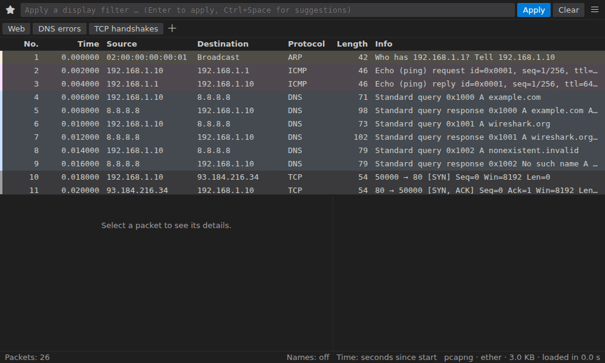
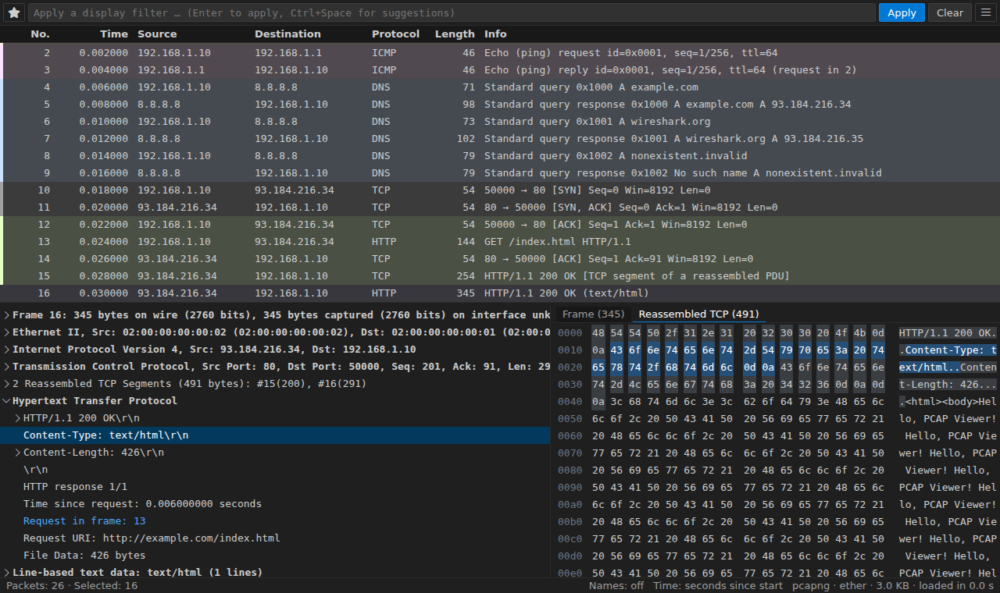
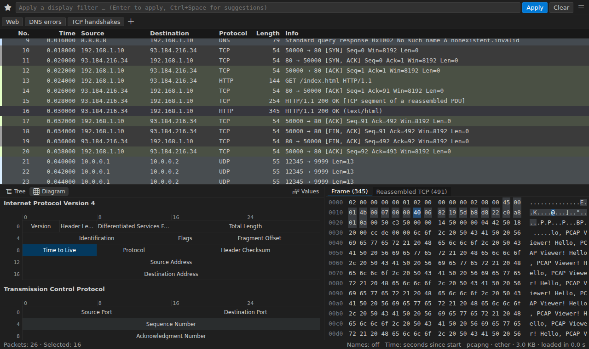
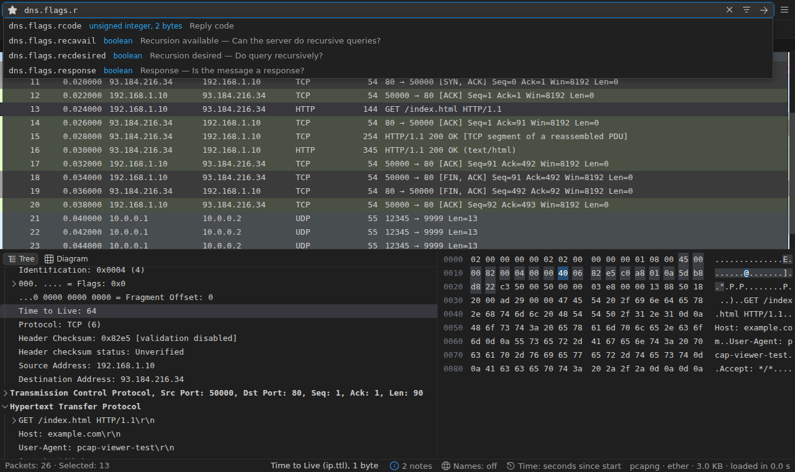
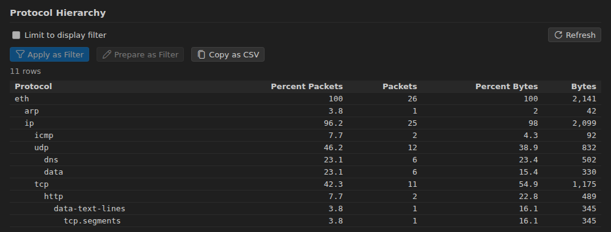

# PCAP Lens

[](https://marketplace.visualstudio.com/items?itemName=denpaz.pcap-viewer)
[](https://marketplace.visualstudio.com/items?itemName=denpaz.pcap-viewer)
[](https://open-vsx.org/extension/denpaz/pcap-viewer)
[](https://open-vsx.org/extension/denpaz/pcap-viewer)
[](https://github.com/DenPaz/pcap-lens/actions/workflows/ci.yml?query=branch%3Amain)

A Wireshark-like viewer for `.pcap` / `.pcapng` captures inside VS Code:
packet list, protocol tree, hex view, filters, statistics, streams, VoIP,
live capture and optional AI help. **tshark** (Wireshark's command-line tool)
does all the dissection and filtering, so results match Wireshark exactly.



## Getting started

1. Install **PCAP Lens** (`denpaz.pcap-viewer`) from the VS Code Marketplace
   or Open VSX, or a `.vsix` from
   [GitHub releases](https://github.com/DenPaz/pcap-lens/releases).
2. Install **tshark** 4.x ([wireshark.org](https://www.wireshark.org/download.html),
   `apt install tshark`, `brew install wireshark`, `choco install wireshark`)
   and **Python 3.12+** (_PCAP: Install Python…_ does it with
   [uv](https://docs.astral.sh/uv/)). The backend uses only Python's standard
   library: nothing to `pip install`. Set `pcapViewer.tsharkPath` /
   `pythonPath` if they aren't found.
3. Run **PCAP: Get Started**: it checks both tools and opens a sample capture.

Until both are installed, a `.pcap` or `.pcapng` (also `.gz`) opens in a
**basic view**: PCAP Lens reads the file itself and shows the packet list
(addresses, protocol, info) and each packet's link, IP, TCP/UDP, ICMP, ARP,
DNS, HTTP and TLS headers with their bytes. Display filters work on those
headers' common fields (`ip.addr == 10.0.0.0/8 && tcp.port in {80, 443}`,
`dns.qry.name contains "example"`, `frame contains "GET"`; Ctrl+Space lists
them), and so do Find Packet, marks and the filter builder. Without
reassembly, a message split over several TCP segments counts at its first one.
Sorting, statistics, streams and everything else need tshark; a banner says
what is missing, and _Reload_ opens the full viewer once it is set up.

Every command is in the Command Palette (`PCAP: …`) and in the viewer's **☰**
menu, grouped and searchable. The **PCAP Lens** view in the activity bar lists
recent captures.

**Files**: `.pcap`, `.pcapng`, `.cap`, `.ntar`, compressed (`.gz`, `.zst`,
`.lz4`), `tcpdump -C` pieces, snoop, ERF, PacketLogger and btsnoop open
directly; `.log`, `.dmp`, `.trc`, `.ber`, `*.[0-9]` through _Reopen Editor
With…_. Any other file tshark reads opens with _PCAP: Open File in PCAP
Lens…_ (or the Explorer's context menu), and a file of BER records with
_Open BER Records as Packets…_ (one packet per record, decoded by the
dissector you pick).

## Features

### Packet list and details



- **Millions of packets**: rows appear within half a second while the file is
  indexed; the index is saved, so reopening is instant and an interrupted
  open resumes.
- **Protocol tree and hex view** with two-way highlighting and reassembled
  data; right-click a field to filter on it, colorize, add a column or copy.
  **Expand All** and **Collapse All** (the tree's buttons, `Ctrl+Right` and
  `Ctrl+Left`, or its menu; `Shift+Right` opens one field's whole subtree)
  stay in effect for the next packets.
  The panes go below, stacked or beside the list, with or without the bytes
  (the toolbar's _Pane Layout_ button).
- **Packet diagram**: each header drawn 32 bits a row, every field to the
  bit, as in Wireshark.
- **Show Packet Bytes**: a field's bytes decoded (Base64, gzip/deflate, hex,
  percent, quoted-printable, ROT13) and shown as text, hex dump, C/Rust array,
  YAML or image.
- **Show Packet in New Window** and **Show File Format** (the pcap/pcapng
  blocks of the file itself).
- **Columns**: sort by any column, add custom columns from any field, hide,
  rename, reorder and resize (double-click a column's separator to fit it to
  its contents); row density and time formats of your choice.
- **Coloring rules** like Wireshark's, with an editor, _Colorize with
  Filter…_ and _Colorize Conversation_; colors adapt to dark and
  high-contrast themes.
- **Overview strip** of colors, marks, comments and Find matches beside the
  list; **status bar** with the selected field and the expert summary.
- **Quick view** of late packets in huge captures (0.3 s instead of a full
  pass), replaced by the exact one when ready.
- **Packet comments** in pcapng files, with undo and save; **name
  resolution** of MAC, IP and port names, never looked up online unless you
  allow it.



### Filters and navigation

- **Display filters** in Wireshark syntax, validated as you type (the part
  tshark refuses is underlined, fields, operators and values in colour), with
  autocomplete from tshark's fields (Lua ones too), history, saved filters
  and one-click **filter buttons**.
- **Filter builder**: find a field by name or description, pick a relation
  and a value seen in the capture.
- **Streaming filters** show matches as they are found; when nothing
  matches, the list says why (a missing field, a case-sensitive comparison).
- **Find Packet** (`Ctrl+F`) by filter, text, regex or hex, in the bytes, the
  list or the details.
- **Frame links**, back/forward history, related-packet marks, conversation
  stepping, **marks**, **ignored packets** and **multi-select**.
- **Compare packets**: two packets' details side by side, differences marked.



### Statistics and streams

Each report opens beside the capture, can be limited to the current filter,
and its rows apply or prepare a filter, go to a packet or copy. Type in
_Filter rows_ (or press Ctrl+F) to narrow a table to the rows holding your
words, instantly.

- **Capture Overview**: the capture at a glance, on one page: totals and
  rates, packets over time, top addresses, protocols, TCP services, and HTTP,
  DNS and TLS breakdowns. Each row applies its filter, and each card opens
  the full report.
- **General**: conversations, endpoints (with a GeoIP world map when MaxMind
  databases are set), protocol hierarchy, expert information, capture
  properties, flow graph.
- **I/O graphs**: up to eight graphs of packets, bytes or a field's
  SUM/MAX/AVG…, lines or bars, linear or log scale.
- **Sessions**: **HTTP Requests** (each request with its status, size and
  response time; _Show Request and Response_ puts both side by side: their
  headers and bodies, JSON, XML, HTML and forms pretty-printed, images
  shown), **DNS Queries**
  (answers, result and latency) and **TLS Servers** (SNI, versions, cipher
  suites, ALPN, connections and failed handshakes).
- **Sequence Check**: name the fields that identify a stream (a LIID and
  CIN, a GTP tunnel, your Lua dissector's fields) and the one that numbers
  its messages; each stream's missing numbers, duplicates, late messages and
  restarts, with 8–32-bit counters that wrap, each a click from its packets.
- **Services**: HTTP, DNS, SIP, packet lengths, service response times,
  credentials sent in the clear.
- **Network**: IPv4/IPv6, UDP multicast streams, resolved addresses, SCTP.
- **Follow stream**: TCP, UDP, TLS, HTTP, HTTP/2, QUIC and WebSocket, as
  ASCII, UTF-8/16, EBCDIC, hex, C arrays, raw or YAML, with search and
  _Filter Out This Stream_.
- **TCP stream graphs**: Stevens, throughput, round-trip time, window.
- **VoIP**: SIP, H.323, MGCP and IAX2 calls with call flow, RTP analysis
  (loss, jitter, RTCP), MOS estimate, DTMF, media problems, and audio to play
  (stereo, with a waveform) or save (G.711, G.722, G.726, L16).



### Capture, edit, export

- **Live capture** on one or more interfaces with a capture filter (saved
  filters too), or through extcap helpers (SSH, Cisco, Android, UDP,
  randpkt); see [Live capture](#live-capture).
- **Follow Growing File**: a capture another program is writing (tcpdump
  `-w`, dumpcap, a collector) shows new packets as they arrive; the viewer
  offers it when an open file grows.
- **Capture to Files** with size/time/packet rotation and ring buffers.
- **Edit**: time shift, remove duplicates, keep a range, truncate, split,
  embed key logs; **merge** captures; **import** a hex dump or a hex stream
  (one packet per line).
- **Export** packets (all, displayed, selected or marked), the list as
  CSV/JSON, dissections as text/PDML/JSON, objects (HTTP, SMB, TFTP, IMF,
  DICOM, FTP-DATA), PDUs, TLS session keys, and a **Capture Report** in
  Markdown or HTML.
- **Firewall ACL rules** for a packet (iptables, nftables, Cisco, pf,
  Windows…).
- **Replay to…**: send a capture's client traffic again to services on your
  machine; see [Replay to Service](#replay-to-service).

New captures stay unsaved until `Ctrl+S`; exports never leave partial files.

### Dissection

- **Decryption**: TLS key logs, Wi-Fi WEP/WPA keys, TLS RSA keys, SSH and
  WireGuard key logs, IPsec ESP and Kerberos, kept in VS Code's secret
  storage.
- **Lua dissectors**: create from a template, reload with error checks,
  choose per capture.
- **Protocol preferences**, **Decode As**, **enabled protocols** and
  heuristics, per workspace folder.
- **Wireshark profiles**: use one, or import its colors, buttons, filters
  and columns.
- **Wireshark plugins**: C dissectors installed for tshark work here too
  (_PCAP: Show TShark Plugins_ opens the folder; build them for your
  Wireshark version).

### AI help (optional)

Through VS Code's Language Model API: GitHub Copilot by default, or any model
you pick (_PCAP: Choose Language Model…_), local ones included. Sending
capture data needs your consent first, and addresses become stand-ins such as
`IP_PRIVATE_1` (see [Security](#security)).

- **PCAP Lens agent** in Copilot Chat: pick _PCAP Lens_ in the agent picker
  (or stay in Agent mode, where the _analyze-capture_ skill applies) and ask
  in plain words, e.g. _what's wrong with this capture?_ or _why do DNS
  lookups fail?_. It answers from tools that compute with tshark (triage,
  overview, failed HTTP/DNS/TLS sessions, TCP connection health, VoIP calls
  and RTP streams, sequence gaps, exported files, clear-text logins, packet
  details, comparison with a baseline file), names the packets and filters,
  and can apply a filter or go to a packet in the viewer after you confirm.
  Any agent can use the tools too: type `#pcapTriage`, `#pcapOverview`…
  The tools read the capture open in the viewer, or one you attach
  (`#file:trace.pcap`) or name: tshark decodes that file, which may be in a
  workspace folder, open in the viewer or in Recent Captures. Copilot sends
  an attached file's own contents to the model as well, whatever PCAP Lens's
  settings say; naming the file in words doesn't. The viewer's AI commands
  (summary, triage, compare, explain packets, _Ask Copilot_ in the panels)
  ask `@pcap` for now; set `pcapViewer.ai.askIn` to `agent` to have them ask
  the PCAP Lens agent instead.
- **Filter suggestions** (✨ or `@pcap`), **capture filters** and **Lua
  dissectors** from a description, all checked by tshark before use.
- **Triage** (`@pcap /triage`): ranked findings from 33 checks tshark counts
  (retransmissions, resets, unanswered requests, errors, scans…).
- **Compare captures** (`@pcap /compare`) against a baseline,
  **summaries**, **explain packets** and **Ask Copilot** in the expert, TCP
  graph and VoIP panels.
- **MCP server** for Claude Code, Claude Desktop, Cursor and VS Code's agent
  mode: read-only tools over capture files (an overview, counts, statistics,
  triage, HTTP requests, DNS queries and TLS servers with their response
  times, VoIP calls with their quality, an RTP stream's loss and jitter over
  time, TCP connection health, sequence-number checks, the files and
  clear-text logins a capture carries, a field's values, comparison and, if
  allowed, packets). It dissects captures as the viewer
  does: your Lua dissectors, Decode As rules, preferences, Wireshark profile
  and tshark's plugins (compiled ones too). VS Code 1.101+ lists it by itself;
  _PCAP: Copy MCP Server Configuration…_ gives the setup for the others.

## Keyboard shortcuts

`Cmd` for `Ctrl` on macOS; `?` in the viewer lists them all.

| Key                               | Action                                 |
| --------------------------------- | -------------------------------------- |
| `Ctrl+/`                          | Apply display filter                   |
| `Ctrl+F`, `F3`, `Shift+F3`        | Find packet, next, previous            |
| `Ctrl+G`, `Ctrl+Home`, `Ctrl+End` | Go to packet, first, last              |
| `Alt+Left`, `Alt+Right`           | Back / forward                         |
| `Ctrl+.`, `Ctrl+,`                | Next / previous packet in conversation |
| `Ctrl+M`, `Ctrl+Shift+N` / `B`    | Mark; next / previous marked           |
| `Ctrl+D`, `Ctrl+T`, `Ctrl+Alt+C`  | Ignore, time reference, packet comment |
| `Ctrl+Right`, `Ctrl+Left`         | Details: expand all, collapse all      |
| `Shift+Right`                     | Details: expand the field's subtree    |
| `Ctrl+A`, `Shift`/`Ctrl`+click    | Select all, select a range or more     |
| `Shift+F10`                       | Context menu                           |

## Settings

Under **PCAP Lens** in the Settings editor (IDs start with `pcapViewer.`).
The most used:

| Setting                                                | What it does                                                         |
| ------------------------------------------------------ | -------------------------------------------------------------------- |
| `tsharkPath`, `pythonPath`                             | Tools to use (empty: auto-detect)                                    |
| `luaScripts`, `dissectorsFolder`, `decodeAs`, `prefs`  | Dissection, per workspace folder                                     |
| `enabledProtocols`, `heuristicDissectors`              | Protocols and heuristics switched on or off                          |
| `tlsKeyLogFile`, `wiresharkProfile`                    | TLS key log; Wireshark profile tshark uses                           |
| `columns`, `columnLayout`, `timeFormat`, `listDensity` | The packet list                                                      |
| `paneLayout`, `showBytesPane`                          | Where the details and bytes go                                       |
| `panelPlacement`                                       | Panels beside the capture or below it                                |
| `coloringRules`, `coloringStyle`                       | Coloring rules and how they are drawn                                |
| `savedFilters`, `filterButtons`                        | Named filters and filter buttons                                     |
| `nameResolution.*`                                     | Which names to show; `external` allows DNS lookups                   |
| `geoip.databaseFolders`                                | MaxMind databases for GeoIP                                          |
| `indexCache.*`, `quickDetail.*`                        | Saved indexes; quick view of late packets                            |
| `capture.*`                                            | Capture limits, promiscuous mode, saved capture filters              |
| `replay.*`                                             | Replay presets; public destinations                                  |
| `ai.*`, `mcp.*`                                        | AI features; what they may send and the model are user settings only |

## Live capture

Capturing runs Wireshark's `dumpcap`, which needs permission:

- **Linux** (Debian, Ubuntu): `sudo dpkg-reconfigure wireshark-common`
  (_Yes_), then `sudo usermod -aG wireshark $USER` and log in again.
  Elsewhere: `sudo setcap cap_net_raw,cap_net_admin=eip $(command -v dumpcap)`.
- **macOS**: install ChmodBPF (in Wireshark's disk image, or
  `brew install --cask wireshark-chmodbpf`) and log in again.
- **Windows**: install [Npcap](https://npcap.com) (comes with Wireshark).

Extcap helpers are the programs in Wireshark's extcap folders; their options
are asked in a form and remembered, except passwords.

## Replay to Service

_PCAP: Replay to…_ sends what a capture's clients sent, with the recorded
timing, to services you run: a lawful-interception collector in Docker, a
SIP server, a test backend. Each recorded server (`tcp 10.20.0.5:11001`)
gets an IP and port to send to; every TCP connection becomes a new
connection carrying its client's bytes once and in order (retransmissions
skipped), every UDP datagram is sent again. No administrator rights needed.

- Speed (real time to no pauses), loops or until stopped, jitter, UDP loss.
- Several captures, one after another or merged by time (_More captures…_).
- Live per-target counts, a log, Stop, and _Save Results…_ as text or JSON.
- Presets for destinations and setup files to share with a team.
- Only this machine, private and link-local addresses unless
  `replay.allowPublicTargets` is set. TLS can't be replayed to a live TLS
  service.

### From the command line

_Copy Command Line…_ in the panel saves the setup and copies a command that
replays it without VS Code, for scripts, CI jobs and long runs. It runs
`pcap-lens-replay.py`, which comes with the extension and needs only Python
3.12 or newer and TShark:

```sh
python3 pcap-lens-replay.py --list delivery.pcapng          # the recorded targets
python3 pcap-lens-replay.py delivery.pcapng --to 127.0.0.1  # each to its recorded port
python3 pcap-lens-replay.py a.pcap b.pcap --map 'tcp/*:11001=127.0.0.1:12001' --order merged
python3 pcap-lens-replay.py --setup lab.json --loops 0 --duration 3600 --results run.json
```

`--map PATTERN=DEST` sends recorded targets (`tcp/10.20.0.5:11001`, `*` for
any host or port) to a host and port; `--to` sends the rest. The panel's
options are there too (`--speed`, `--loops`, `--order`, `--jitter`,
`--loss`, `--filter`), plus `--duration`, `--json` (progress as JSON lines)
and `--results` (what _Save Results…_ writes). Ctrl+C stops cleanly. The exit
status is 0 when everything was delivered, 1 when a connection was refused or
reset or the service didn't read everything, 2 for a usage error and 3 when
the captures can't be read. `--help` lists everything.

## Remote windows

In WSL, SSH, Dev Containers and Codespaces everything runs on the remote
machine: install tshark and Python there. Captures that aren't files on disk
(Live Share, archives) open as an unsaved copy, without asking up to 256 MB
(`pcapViewer.virtualFiles.autoCopyMB`). In **Restricted Mode** the tool paths
and Lua dissectors come from user settings only.

## Troubleshooting

| Symptom                                      | Fix                                                                                                                                                          |
| -------------------------------------------- | ------------------------------------------------------------------------------------------------------------------------------------------------------------ |
| "No Python 3.12+ interpreter found"          | _PCAP: Install Python…_, or set `pcapViewer.pythonPath`.                                                                                                     |
| "tshark was not found"                       | Install tshark or set `pcapViewer.tsharkPath`.                                                                                                               |
| "You don't have permission to read the file" | Ubuntu's AppArmor profile for tshark: add `owner @{HOME}/** rw,` to `/etc/apparmor.d/local/tshark` and run `sudo apparmor_parser -r /etc/apparmor.d/tshark`. |
| Stopping a filter is slow ("could not stop") | Same file: add `signal (receive) peer=unconfined,` and `signal (receive) peer=vscode,`.                                                                      |
| A Lua dissector or plugin isn't applied      | _PCAP: Show Log_; tshark ignores Lua and personal plugins as root; plugins must match your Wireshark version.                                                |
| TLS stays encrypted                          | The key log must hold the capture's sessions (set `SSLKEYLOGFILE` before capturing).                                                                         |
| Huge files open slowly                       | That is tshark's speed; `"pcapViewer.prefs": { "tcp.analyze_sequence_numbers": false }` helps.                                                               |

## Security

- tshark and Python always run with argument arrays, never through a shell.
- Packet contents are untrusted: the webviews insert them only as text, under
  a strict Content-Security-Policy.
- Decryption keys live in VS Code's secret storage (tshark gets them on its
  command line, visible in the process list).
- AI requests go through VS Code's Language Model API; `ai.enabled: false`
  turns them off. The `allow*` settings are user-only, and with
  `ai.pseudonymizeAddresses` (on) addresses and host names are replaced by
  stand-ins in everything sent (packet bytes are then never sent).
- The MCP server only reads captures inside its folders and opens no port.
  The chat tools only read a capture you name when it is in a workspace
  folder, open in the viewer or in Recent Captures.

| AI feature                                                               | What is sent                                                                                                         | Needs                    |
| ------------------------------------------------------------------------ | -------------------------------------------------------------------------------------------------------------------- | ------------------------ |
| Filter, capture filter and Lua help                                      | Your description, the current filter, protocol and field names                                                       | `ai.enabled`             |
| Triage, summary, compare, `/anomaly`                                     | Capture properties, counts, top conversations/endpoints, expert entries (capped)                                     | `allowCaptureStatistics` |
| Tools: field search, apply filter, go to packet                          | Field names you search for; nothing from the capture                                                                 | `ai.enabled`             |
| Tools: count, stats, triage, overview, TCP stream, compare, capture info | Filters and counts, statistics tables (25 rows), overview top 10s, a TCP stream's health, a comparison's changes     | `allowCaptureStatistics` |
| Tools: VoIP calls, RTP stream, sequence check, exported files, logins    | Calls and streams (25), loss and jitter, sequence problems, file sizes and types, login protocols and packets        | `allowCaptureStatistics` |
| In those: DTMF digits, file names, user names, text key values           | Only with packet data allowed (passwords never)                                                                      | `allowPacketData`        |
| Explain packets, tools: list packets, sessions, packet details           | Up to 8 packets' rows and trees (tools: 20 rows, 30 sessions, 4 trees, no bytes); bytes only with `allowPacketBytes` | `allowPacketData`        |

## How it works

```
Webview (HTML/JS) --postMessage--> Extension host (TypeScript)
                                     | JSON-RPC over stdio
                                     v
                                   Python backend (stdlib only)
                                     | argv-only subprocesses
                                     v
                                   tshark, dumpcap, editcap, mergecap, text2pcap
```

One `tshark` pass indexes the list into a file (8 bytes per packet), filters
keep matching frame numbers, details dissect only up to the packet. On
1,000,000 packets (146 MB): open about 30 s with rows after 0.5 s, reopen
0.01 s, a page < 1 ms, sort 0.5 s, backend memory 125 MB.

## Contributing and license

See [CONTRIBUTING.md](CONTRIBUTING.md) and [CHANGELOG.md](CHANGELOG.md).
MIT licensed. **tshark is part of Wireshark (GNU GPL v2)**: the extension
runs the tshark you installed as a separate process and doesn't bundle,
link to or modify it. Icons: Microsoft's
[Codicons](https://github.com/microsoft/vscode-codicons) (CC BY 4.0 / MIT).
