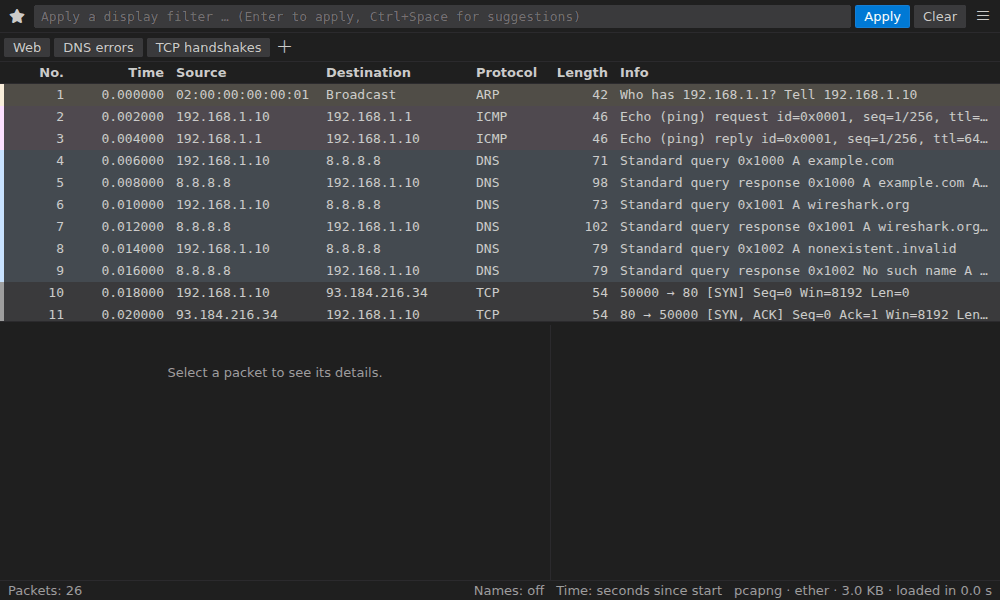
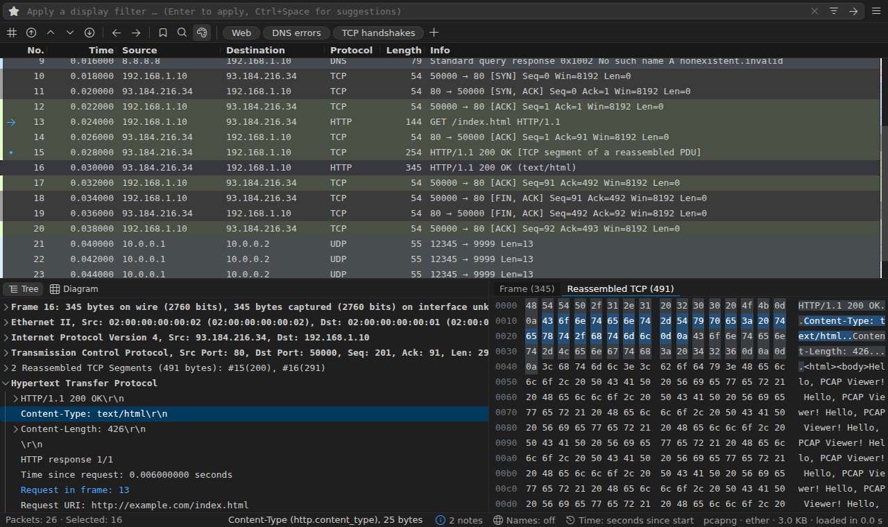
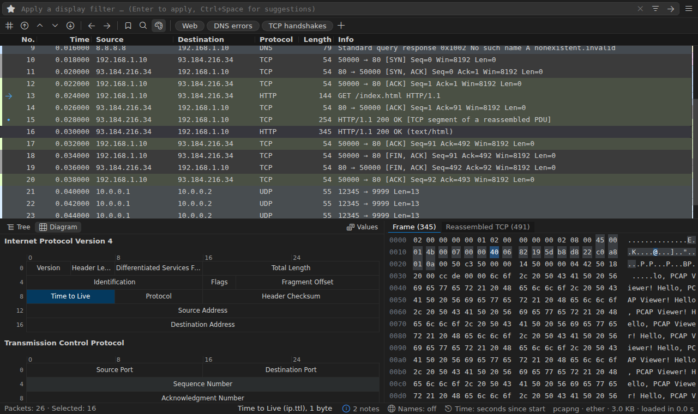
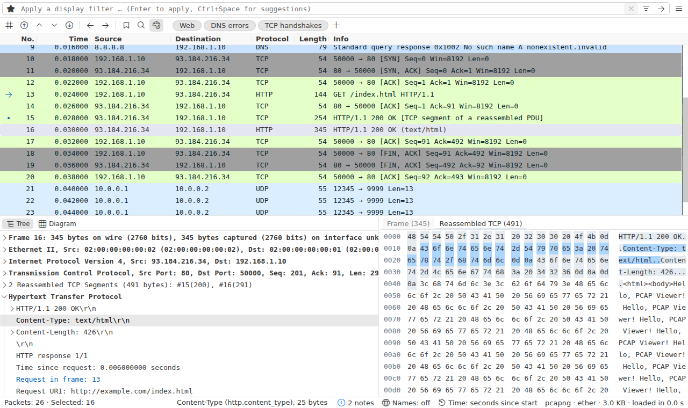
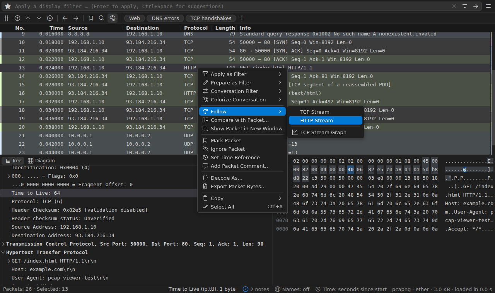
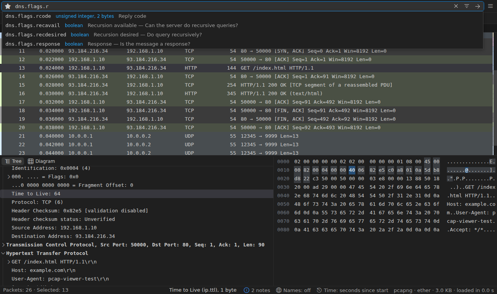
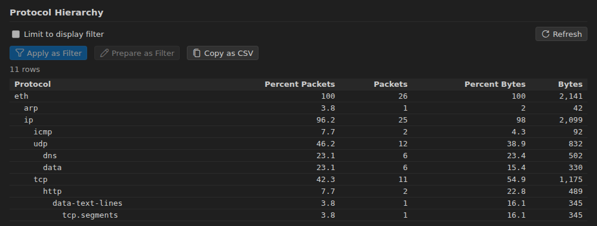

# PCAP Lens

[](https://marketplace.visualstudio.com/items?itemName=denpaz.pcap-viewer)
[](https://marketplace.visualstudio.com/items?itemName=denpaz.pcap-viewer)
[](https://open-vsx.org/extension/denpaz/pcap-viewer)
[](https://open-vsx.org/extension/denpaz/pcap-viewer)
[](https://github.com/DenPaz/vsc_pcap_viewer/actions/workflows/ci.yml?query=branch%3Amain)

Open `.pcap` / `.pcapng` captures in VS Code with a Wireshark-like packet list,
protocol tree and hex view. **tshark** (Wireshark's command-line tool) does all
dissection and filtering, so results match Wireshark exactly.



## Getting started

1. Install **PCAP Lens** (extension ID `denpaz.pcap-viewer`; it was called
   PCAP Viewer before 0.4.1) from the VS Code Marketplace or Open VSX, or
   download the `.vsix` from
   [GitHub releases](https://github.com/DenPaz/vsc_pcap_viewer/releases) and
   run `code --install-extension pcap-viewer-<version>.vsix`.
2. Install the [requirements](#requirements): **tshark** and **Python 3.12+**.
3. Run **PCAP: Get Started** (also under _Help › Welcome_). The walkthrough
   checks both tools, says how to install what's missing and opens a sample
   capture.

Then open any capture file. Every command is in the Command Palette (`PCAP: …`)
and in the viewer's **☰** menu at the end of the filter bar, grouped under
headings that unfold on click (or `→`); typing searches them all.

The **PCAP Lens** view in the activity bar lists your recent captures with
their packet counts, sizes and when you opened them; click one to open it
again. While it's empty it offers to open a file, the sample capture or start
a live capture.

### Requirements

- **tshark** 4.x, from Wireshark: [wireshark.org](https://www.wireshark.org/download.html),
  `apt install tshark`, `brew install wireshark` or `choco install wireshark`.
  Found on `PATH` or in the default install locations, else set
  `pcapViewer.tsharkPath`. Older 3.x releases work too.
- **Python 3.12+** on `PATH` (`python3.14` … `python3.12`, `python3`, `python`,
  `py -3`), or installed with [uv](https://docs.astral.sh/uv/), or set
  `pcapViewer.pythonPath`. _PCAP: Install Python…_ installs it with uv when
  uv is there. The backend uses only the standard library: nothing to
  `pip install`.

### Supported files

tshark recognises the format from the content; the file name only decides
which editor VS Code offers.

- **Open in the viewer**: `.pcap`, `.pcapng`, `.cap`, `.ntar`, the same
  compressed (`.gz`, `.zst`, `.lz4`), `tcpdump -C` pieces (`.pcap0`,
  `.pcap1`, …), `.snoop`, `.erf`, `.pklg`, `.btsnoop`.
- **Offered in _Reopen Editor With…_ only**: `*.[0-9]`, `.log`, `.dmp`,
  `.trc`, `.ber` (generic names that are sometimes captures).

**Any other name**, or no extension at all: right-click the file in the
Explorer, or run _PCAP: Open File in PCAP Lens…_ and pick it. It opens if
tshark reads it (Network Monitor, Sniffer, a raw BER/ASN.1 value…), else you
are told why. zstd and LZ4 need a tshark built with them (`tshark
--version`).

**A file of BER records** (several BER/ASN.1 values back to back, as call
detail records and other record files are written) isn't readable as such:
tshark reads one BER value per file. _PCAP: Open BER Records as Packets…_ (also
offered when you open such a file) turns it into an unsaved capture with one
packet per record, decoded by the dissector you choose: `ber` (generic tags
and values), any of tshark's, or your Lua dissector's name (a Lua `Proto` is
registered under its name in lower case).

## Features

### Packet list and details

- **Millions of packets** scroll smoothly: only visible rows are drawn, pages
  come from a cached index, and scrolling never re-runs tshark.
- **Fast opening**: the first packets show within half a second while the rest
  is indexed (progress bar and status bar). The index is saved, so reopening an
  unchanged capture is instant; closing mid-way keeps the progress for next time.
- **Protocol tree and hex view** with two-way highlighting, reassembled data
  included. Right-click a field to apply or prepare it as a filter, colorize,
  add it as a column or copy it.
- **Show Packet Bytes** (right-click a field): its bytes decoded from Base64,
  gzip/zlib/deflate, hex digits, percent-encoding, quoted-printable or ROT13,
  shown as text (ASCII, UTF-8, UTF-16, ISO 8859-1, EBCDIC), a hex dump, a C
  or Rust array, YAML or an image, from any start to end byte; search it,
  copy it, save it as shown or raw.
- **Show Packet in New Window** (right-click a packet): its details and
  bytes in a panel of their own that stays while you select other packets.
- **File format view** (_PCAP: Show File Format_): the capture file itself,
  as Wireshark's _Reload as File Format_ shows it: the pcap header and
  records, or every pcapng block and option, over the file's bytes.

  

- **Packet diagram**: switch the details from _Tree_ to _Diagram_ to see each
  protocol's header drawn 32 bits a row, every field to the bit, as in
  Wireshark. Pick a field to select it in the tree and its bytes; _Values_
  shows the fields' values.

  

- **Field info in the status bar**: the selected field's name, filter field
  and size, as in Wireshark ("Time to Live (ip.ttl), 1 byte").
- **Overview strip** beside the packet list: the whole view's colors, marks,
  comments and Find matches in one column; click or drag it to scroll there.
- **Quick view of late packets**: from packet 20,000 on, details show in about
  0.3 s by dissecting only the 300 packets before it, until the exact view
  replaces it.
- **Columns**: sort by any column (addresses numerically, time by the format
  shown); add custom columns from any field; hide, rename, reorder and resize.
- **Multi-select** with `Shift`/`Ctrl`+click, `Shift`+arrows and `Ctrl+A`; mark,
  copy or export the selection.
- **Coloring rules** like Wireshark's (default set included, first match wins),
  with an editor (_PCAP: Edit Coloring Rules_) and _Colorize with Filter…_.
  Colors follow the theme: a tint and a stripe in dark themes, a stripe in high
  contrast (`pcapViewer.coloringStyle` to choose). Right-click a packet and
  _Colorize Conversation…_ to color its Ethernet, IP, TCP or UDP conversation
  in one of ten colors for this editor (_Reset Colorization_ clears them).

  

- **Packet comments** in pcapng files: shown on the row and above the details;
  edit with `Ctrl+Alt+C`, undo with `Ctrl+Z`, save into the file with `Ctrl+S`.
- **Name resolution** for MAC addresses, IP addresses (from the capture's DNS
  answers and hosts files) and ports: _PCAP: Name Resolution…_. Nothing is
  looked up on the network unless you allow it.
- **Time formats** (relative, deltas, absolute, UTC, epoch) and a time
  reference (`Ctrl+T`).

### Menus and toolbar

- **Context menus with submenus**: right-click a packet or a field for _Apply
  as Filter ›_ and _Prepare as Filter ›_ (Selected, Not Selected and, with a
  filter applied, …and/…or (not) Selected, each showing the filter it makes),
  _Conversation Filter ›_, _Colorize Conversation ›_, _Follow ›_ (the streams
  that packet is part of), _Copy ›_ and more, with icons and key bindings.
  What doesn't apply to the packet isn't listed. `Shift+F10` or the menu key
  opens them from the keyboard. The panels' tables (statistics, Export
  Objects, VoIP calls and streams) have row menus too.

  

- **☰ All commands** at the end of the filter bar: every PCAP Lens command
  under its heading (Packets, Streams, Statistics, Network Statistics, Service
  Statistics, Telephony, Export…), the ones you ran lately first; type to
  filter.
- **The editor's title bar**: Start/Stop Capture, Find Packet, Follow Stream,
  a _Statistics_ menu with every report, and the coloring switch; Reload, the
  exports and the capture report in its _…_ menu.
- **Toolbar** under the filter: go to a packet, first, previous, next, last,
  back, forward, mark, find and coloring.
- **Row height**: `pcapViewer.listDensity` (compact, normal, comfortable).

### Display filters

- Wireshark syntax, **validated as you type**; invalid filters are never applied.
- **Autocomplete** from tshark's field list, including your Lua dissectors'
  fields: `Tab` takes the first suggestion.
- **Filter builder** (the filter bar's builder button, or right-click a field
  › _Build Filter from Field…_): find a field by name or description ("time to
  live"), pick a relation that suits its type and a value from those seen in
  the capture, then apply the filter or add it to the one in the bar.
- **When nothing matches**, the list says why: a field that no packet has, or
  a case-sensitive text comparison (with the case-insensitive filter to try).
  It also offers to go back to the previous filter, edit it or build a new
  one.
- **Streaming**: on big captures matches show as they are found; ■ stops and
  keeps them. Finished results are cached with the index.
- **Saved and recent filters** (★), and **filter buttons** under the filter
  bar for one-click filters (**+** adds one; right-click to edit).
- **Conversation Filter**: right-click a packet to show only its Ethernet, IP,
  TCP or UDP conversation.

  

### Navigation

- **Find Packet** (`Ctrl+F`) by display filter, string, regular expression or
  hex bytes. Text is looked for in the packet bytes, the packet list's columns
  or the packet details; a match in the details selects its field.
- **Frame links** in the tree (_Request in frame_, _ACK of frame_…) with
  back/forward history (`Alt+Left`/`Alt+Right`). The packets they refer to
  are marked in the list while the packet is selected: an arrow on the request
  it answers, a check on the segment it acknowledges, a dot on the rest.
  Captures of up to 10,000 packets (`pcapViewer.twoPassDetail`) are dissected
  twice for the details, as Wireshark does, so a request also names (and
  marks) its response.
- Next/previous packet in the conversation, first/last, go to packet, and
  **marks** (`Ctrl+M`) with next/previous marked.
- **Compare packets**: select two packets (or one, and give the other's
  number) and _Compare…_ from the row menu shows their details side by side,
  the fields that differ marked; _Only differences_ hides the rest.
- **Ignore packets** (`Ctrl+D`): they stay in the list, dimmed, but statistics,
  the status bar's expert counts and exports leave them out.

### Statistics and graphs

Each report opens in a panel beside the capture, can be limited to the current
filter, and its rows apply or prepare the matching display filter: right-click
a row for _Apply as Filter ›_ and _Prepare as Filter ›_ (alone or combined
with the capture's filter), _Go to Packet_ and _Copy ›_.

- Conversations, Endpoints, Protocol Hierarchy, I/O Graph, Expert Information,
  Capture File Properties. The status bar shows the capture's most severe
  expert findings ("3 warnings"); click it for Expert Information.
- **I/O graphs** with up to eight graphs, each a display filter and a Y axis:
  packets, bytes, bits, or SUM, COUNT, MAX, MIN, AVG or LOAD of a field (say
  `tcp.analysis.ack_rtt`), as lines or bars, on a linear or log scale. The
  graphs are kept for the next I/O graph.
- **Credentials**: the usernames logins carried in the clear (HTTP Basic, FTP,
  POP, IMAP…), each linked to its packet.
- **IPv4 and IPv6 statistics**: all addresses, source and destination
  addresses, protocol types, destinations and ports. **UDP multicast
  streams** with packets per second, bandwidth and 100 ms bursts (more than 50
  raise an alarm). **Resolved addresses** (the names the capture's DNS answers
  gave) and **SCTP associations** (chunks per direction).
- **GeoIP**: with MaxMind databases (GeoLite2 City, Country, ASN) in
  `pcapViewer.geoip.databaseFolders` or tshark's usual folders, IP endpoints
  get country, city and AS columns and a world map of where they are, and the
  `ip.geoip.*` fields work in the details and in filters.
- HTTP (status codes, requests by host, load by server), DNS, packet lengths,
  service response times (ICMP, SMB, LDAP, SNMP, Diameter, GTP…) and SIP
  (messages, resends, response codes, request methods, setup times).
- **Flow graph** of the displayed packets, and **TCP stream graphs** (Stevens,
  throughput, round-trip time, window).
- **VoIP calls**: SIP, H.323, MGCP and IAX2 calls with their call flow, RTP
  streams (and IAX2's own voice frames) with loss and jitter, per-packet
  stream analysis, and audio to play or save as WAV (G.711, G.722, G.726-32
  and L16; other codecs as their raw payload). _Play Call_ plays both
  directions together (caller left, callee right) over a waveform you can
  click to seek; _Save Call Audio…_ writes that stereo file. Each stream shows
  what the receiver's RTCP reports said (loss, jitter, round trip), and a
  Registrations table lists SIP REGISTER results (challenges, refusals,
  unregistrations).
  For each call: how long it rang and took to answer, who hung up and why
  (final response, `Reason` header or release cause such as "Q.850 cause
  16"), an estimated MOS (ITU-T E-model, from loss, jitter and codec), the
  DTMF digits sent (RFC 4733 events, SIP INFO, H.245 user input, IAX2 DTMF
  frames; for MGCP also the digits dialled), and media problems: no media or
  one-way audio after the answer, a codec the signalling didn't agree on, an
  SSRC change, long silences. _Filter Call_ shows the call's packets; _Save Call…_ writes them
  to a new capture; _Ask Copilot…_ explains the call.
- **Follow TCP / UDP / TLS / HTTP / HTTP/2 / QUIC / WebSocket stream**, with
  each HTTP/2 or QUIC stream of a connection picked from a list (QUIC and
  HTTP/2 over TLS need the TLS key log). Show the data as ASCII, UTF-8, UTF-16,
  ISO 8859-1, EBCDIC, hex dump, C arrays, raw or YAML, search it (`Ctrl+F`,
  matches highlighted), step to the previous/next stream, and use _Filter to
  Stream_ / _Filter Out This Stream_ for the packet list.

  

### Capture, edit, export, import

- **Live capture** (_PCAP: Start Capture…_) on one or more interfaces with a
  capture filter; the list fills as packets arrive. Needs
  [permission to capture](#live-capture). The filter box keeps **saved capture
  filters** (its bookmark and save buttons).
- **Remote and other capture helpers** (Wireshark's extcap): capture over SSH
  (`sshdump`), from Cisco routers (`ciscodump`), Android devices
  (`androiddump`), a UDP port (`udpdump`) or Wireshark's packet generator
  (`randpkt`), with each helper's own options asked in a form.
- **Capture to Files** (_PCAP: Capture to Files…_): straight into files, like
  Wireshark's output options: a new file every so many MB, seconds or packets,
  a ring buffer that keeps the newest ones, stop after N files, pcapng or pcap.
  Then open the latest file or merge them all.
- **Capture editing** (_PCAP: Edit Capture…_): time shift, remove duplicates,
  keep a range, truncate, split, embed a TLS, SSH or WireGuard key log. The
  result is a new capture.
- **Export** packets (displayed, all, selected or marked) to pcapng/pcap, the
  packet list to CSV/JSON, packet bytes, full dissections as text, PDML or
  JSON, and the TLS session keys tshark could decrypt as a key log.
- **Capture Report** (_PCAP: Capture Report…_): the capture's properties,
  protocol hierarchy, top conversations and endpoints, expert information and,
  if you like, the displayed packets, as Markdown or one HTML file to share.
  Made locally, without AI.
- **Firewall ACL Rules** for the selected packet: iptables, nftables, Cisco
  IOS, IP Filter, ipfw, pf and Windows Firewall rules by address and port,
  denying or allowing, to copy.
- **Export Objects**: files carried over HTTP, SMB, TFTP, IMF, DICOM and
  FTP-DATA.
- **Export PDUs to File**: what one of tshark's export taps collects (each
  packet's transport payload, the SIP or Diameter messages, the IP
  packets…) from the displayed or all packets, as a new capture.
- **Merge captures**, with an offer to merge a rotated capture's pieces.
- **Import from Hex Dump** (text2pcap) from the editor, the clipboard or a file.

New captures stay unsaved until `Ctrl+S`. Exports never leave a partial file
and never overwrite the open capture.

### Dissection

- **TLS decryption** with an `SSLKEYLOGFILE` key log (_PCAP: Set TLS Key Log
  File…_); the viewer offers a reload when the file gets new keys.
- **Decryption keys** (_PCAP: Decryption Keys…_): Wi-Fi WEP keys, WPA/WPA2
  passphrases and pre-shared keys, TLS RSA private keys, SSH and WireGuard key
  logs, IPsec ESP security associations and Kerberos keytabs. They are kept in
  VS Code's secret storage (not in settings files) and apply to every capture,
  like Wireshark's own key tables, which tshark still reads too.
- **Enabled protocols** (_PCAP: Enabled Protocols…_): switch protocols and
  heuristic dissectors on or off for a workspace folder (say, RTP on any UDP
  port), starting from what you set in Wireshark; _Disable Protocol_ in the
  packet details' menu switches one off at once.
- **Lua dissectors**: _PCAP: New Lua Dissector…_ scaffolds one, _PCAP: Reload
  Dissectors_ checks it and links errors to their line (see
  `backend/dissectors/example.lua`). _PCAP: Lua Dissectors…_ (or the status
  bar's _Lua_ link) picks which scripts each capture loads; the choice is
  remembered per file. A Lua dissector registered on `wtap_encap` 90 decodes
  whole BER files: `DissectorTable.get("wtap_encap"):add(90, proto)`; for a
  file of several BER records, pick it by name in _Open BER Records as
  Packets…_.
- **Protocol preferences**: right-click a protocol in the packet details (or
  _PCAP: Protocol Preferences…_) to see its tshark preferences with their
  descriptions and current values, and change them; values are checked, the
  capture reloads, ↺ goes back to Wireshark's value. Changes are stored in
  `pcapViewer.prefs`, per workspace folder.
- **Decode As** rules, per workspace folder.
- **Wireshark profiles**: _PCAP: Use Wireshark Profile…_ makes tshark use one
  of your configuration profiles (or one Wireshark ships): its preferences,
  Decode As rules, display filter macros (`${name:args}`) and disabled
  protocols. _PCAP: Import from Wireshark Profile…_ copies its coloring
  rules, filter buttons, saved display filters and packet list columns into
  PCAP Lens's settings.
- **Wireshark plugins** (dissectors in C): installed once for tshark, used by
  the viewer too; see [Wireshark plugins](#wireshark-plugins).

### AI help (optional)

Through VS Code's Language Model API (GitHub Copilot). Everything that sends
capture data asks first; see [Security](#security) for exactly what is sent.

- **Filter suggestions**: ✨ in the filter bar or `@pcap` in chat. Suggestions
  are checked with tshark; no packet data is sent.
- **Explain packets**: right-click _Ask Copilot About This Packet…_ or
  `@pcap /explain 12 15-17`.
- **Summaries and anomalies**: `@pcap /summary`, and _Ask Copilot_ in the Expert
  Information, TCP Stream Graph and VoIP Calls panels (`@pcap /anomaly`).
- **Questions with tools**: `@pcap how many DNS queries got no answer?` counts
  and looks things up read-only in the open capture.

## Keyboard shortcuts

On macOS use `Cmd` for `Ctrl`. They apply while a capture is the active editor.
Press `?` in the viewer (or _PCAP: Keyboard Shortcuts_) for this list.

| Key                            | Action                                  |
| ------------------------------ | --------------------------------------- |
| `Ctrl+/`                       | Apply display filter                    |
| `Ctrl+F`, `F3`, `Shift+F3`     | Find packet, next, previous             |
| `Ctrl+G`                       | Go to packet                            |
| `Alt+Left`, `Alt+Right`        | Back / forward through jumps            |
| `Ctrl+.`, `Ctrl+,`             | Next / previous packet in conversation  |
| `Ctrl+Home`, `Ctrl+End`        | First / last packet                     |
| `Ctrl+A`                       | Select all displayed packets            |
| `Ctrl+M`                       | Mark / unmark selected packets          |
| `Ctrl+Shift+N`, `Ctrl+Shift+B` | Next / previous marked packet           |
| `Ctrl+T`                       | Set / unset time reference              |
| `Ctrl+Alt+C`                   | Add or edit packet comment              |
| `Enter` / `→` in the list      | Move to the protocol tree               |
| Arrow keys on a pane divider   | Resize the panes (`Home`/`End`: limits) |
| `Esc`                          | Restore the filter, close the find bar  |
| `?`                            | Show the keyboard shortcuts             |

## Settings

They are under **PCAP Lens** in the Settings editor, and their IDs start with
`pcapViewer.` (the extension's former name, kept so existing settings still
apply). Those marked † can differ per workspace folder; those marked ‡ can only
be set in user settings.

| Setting                                                                     | What it does                                                                |
| --------------------------------------------------------------------------- | --------------------------------------------------------------------------- |
| `tsharkPath`, `pythonPath`                                                  | Tools to use (empty: auto-detect)                                           |
| `luaScripts`†, `dissectorsFolder`†                                          | Lua dissectors to load                                                      |
| `decodeAs`†, `prefs`†                                                       | Decode As rules (`"tcp.port==8080,http"`) and preference overrides          |
| `tlsKeyLogFile`†                                                            | TLS key log for decryption                                                  |
| `wiresharkProfile`†                                                         | Wireshark configuration profile tshark uses (empty: Default)                |
| `enabledProtocols`†, `heuristicDissectors`†                                 | Protocols and heuristic dissectors switched on or off                       |
| `geoip.databaseFolders`                                                     | Folders of MaxMind databases for GeoIP                                      |
| `columns`†, `columnLayout`                                                  | Custom columns; column order and hidden columns                             |
| `timeFormat`                                                                | `relative`, `delta_displayed`, `delta_captured`, `absolute`, `utc`, `epoch` |
| `savedFilters`, `filterButtons`                                             | Named filters and filter buttons (user or workspace)                        |
| `coloringRules`, `colorize`                                                 | Coloring rules (first match wins) and coloring on/off                       |
| `coloringStyle`                                                             | `auto` (for the theme), `full`, `subtle` (tint and stripe) or `stripe`      |
| `nameResolution.mac` / `.network` / `.capturedDns` / `.transport`           | Which names to show                                                         |
| `nameResolution.external`‡                                                  | Also ask your DNS server (off)                                              |
| `capture.stopAfterPackets` / `Seconds` / `Megabytes`, `capture.promiscuous` | Live capture limits and mode                                                |
| `indexCache.enabled`, `indexCache.maxSizeMB`                                | Saved indexes (on, 1 GB)                                                    |
| `quickDetail.after`, `quickDetail.window`                                   | Quick view from packet 20,000, of 300 packets (`0`: never)                  |
| `maxCachedFrames`, `requestTimeoutSeconds`                                  | Backend cache budget; timeout of quick requests                             |
| `ai.enabled`                                                                | Offer AI help when a model is available (on)                                |
| `ai.allowPacketData`‡, `ai.allowCaptureStatistics`‡, `ai.allowPacketBytes`‡ | What AI features may send (off; asked once)                                 |

## Live capture

Capturing runs Wireshark's `dumpcap`, which needs permission:

- **Linux**: `sudo dpkg-reconfigure wireshark-common` (answer _Yes_), then
  `sudo usermod -aG wireshark $USER` and log in again; elsewhere
  `sudo setcap cap_net_raw,cap_net_admin=eip $(command -v dumpcap)`.
- **macOS**: install ChmodBPF (in Wireshark's disk image, or
  `brew install --cask wireshark-chmodbpf`), then log in again.
- **Windows**: install [Npcap](https://npcap.com) (included with Wireshark).

Capture helpers (extcap) are the programs in Wireshark's extcap folders (_Help
→ About Wireshark → Folders_; yours can go in the personal one). tshark runs
them, so _Start Capture_ lists the interfaces tshark sees. Their options are
remembered per interface, except passwords, which are asked again in each VS
Code session; prefer an SSH key or agent.

Unsaved captures live in the extension's storage and are removed after 7 days
if left behind.

## Wireshark plugins

Dissectors written in C can be built as Wireshark plugins (a `.so` file, `.dll`
on Windows). tshark loads them, so the viewer does too, with nothing to
configure:

1. Get the plugin built for your Wireshark's version: Wireshark 4.6.x (see
   `tshark --version`) only loads plugins built for 4.6.
2. Run _PCAP: Show TShark Plugins_ and choose _Open Personal Plugin Folder_
   (`~/.local/lib/wireshark/plugins/4.6/epan` on Linux,
   `~/.local/lib/wireshark/plugins/4-6/epan` on macOS, where Wireshark writes
   the version with a dash, `%APPDATA%\Wireshark\plugins\4.6\epan` on
   Windows; it is created if missing). Copy the plugin there.
3. Reopen the capture or run _PCAP: Reload Capture_. _PCAP: Show TShark
   Plugins_ now lists it under _Your plugins_; its fields work in filters,
   columns and autocomplete, and saved indexes are rebuilt with it.

A plugin's preferences can be changed with _PCAP: Protocol Preferences…_ (they
go into `pcapViewer.prefs`), and _PCAP: Decode As…_
moves its dissectors to other ports. Wireshark ignores personal plugins when it
runs as root. In a remote window, install the plugin on the remote machine,
where tshark runs. Lua dissectors need none of this (see
[Dissection](#dissection)).

## Remote windows

In a remote window (WSL, SSH, Dev Containers, Codespaces) the extension, Python,
tshark and live captures all run **on the remote machine**, so install the
tools there and set `pythonPath`/`tsharkPath` in the Remote settings. A Dev
Container example:

```jsonc
{
  "image": "mcr.microsoft.com/devcontainers/python:3.14",
  "postCreateCommand": "sudo apt-get update && sudo DEBIAN_FRONTEND=noninteractive apt-get install -y tshark",
  "customizations": { "vscode": { "extensions": ["denpaz.pcap-viewer"] } },
  // Only for live capture:
  // "runArgs": ["--cap-add=NET_RAW", "--cap-add=NET_ADMIN"],
  // "postStartCommand": "sudo setcap cap_net_raw,cap_net_admin=eip /usr/bin/dumpcap"
}
```

Captures that aren't files on disk (Live Share, archives) open as a copy. In
**Restricted Mode** the tool paths and Lua dissectors come from user settings
only, so an untrusted repository can't run its own programs.

## Troubleshooting

| Symptom                                                         | Fix                                                                                                                                                                                                                        |
| --------------------------------------------------------------- | -------------------------------------------------------------------------------------------------------------------------------------------------------------------------------------------------------------------------- |
| "No Python 3.12+ interpreter found"                             | Run _PCAP: Install Python…_, set `pcapViewer.pythonPath` (e.g. to the output of `uv python find`), or start VS Code from a terminal where `python3` is 3.12 or newer.                                                      |
| "tshark was not found"                                          | Install tshark or set `pcapViewer.tsharkPath`.                                                                                                                                                                             |
| "You don't have permission to read the file" (yours)            | Ubuntu's AppArmor profile for tshark allows only `/tmp`. Add `owner @{HOME}/** rw,` to `/etc/apparmor.d/local/tshark`, then `sudo apparmor_parser -r /etc/apparmor.d/tshark`. Snap tshark: use the distribution's package. |
| Stopping a filter is slow; the log says "could not stop tshark" | The same profile blocks signals. Add `signal (receive) peer=unconfined,` and `signal (receive) peer=vscode,` to the same file and reload it.                                                                               |
| A Lua dissector isn't applied                                   | Check _PCAP: Show Log_. tshark disables Lua as root. _PCAP: Reload Dissectors_ after editing.                                                                                                                              |
| A Wireshark plugin's protocols are missing                      | _PCAP: Show TShark Plugins_: a plugin that isn't listed was built for another Wireshark version or is in the wrong folder (_Open Personal Plugin Folder_). Not as root.                                                    |
| TLS stays encrypted                                             | The key log must contain the capture's sessions: set `SSLKEYLOGFILE` before capturing and don't clear the file.                                                                                                            |
| Opening a huge file is slow                                     | That is tshark's speed. `"pcapViewer.prefs": { "tcp.analyze_sequence_numbers": false }` makes it cheaper.                                                                                                                  |
| The first capture after installing Wireshark takes long to open | macOS checks Wireshark.app the first time tshark runs, which can take a minute; later opens are fast. _PCAP: Show Log_ shows how long each step took.                                                                      |

_PCAP: Show Log_ shows backend and tshark messages.

## Security

- tshark and Python run with argument arrays, never through a shell.
- Packet contents are untrusted: the webview inserts them only as text, under
  a strict Content-Security-Policy with a per-load nonce, and can only call an
  allow-list of backend methods.
- CSV exports prefix cells that look like formulas with `'`.
- **Decryption keys** stay in VS Code's secret storage. tshark gets them as
  command-line options, so other users of the same computer could see them in
  the process list while a capture is being read; use a key file (RSA, SSH,
  WireGuard, Kerberos) where that matters. The same goes for capture helpers'
  options (an SSH password, for instance).
- **AI requests** go through VS Code's Language Model API, so VS Code asks for
  consent and your Copilot policies apply. `"pcapViewer.ai.enabled": false`
  turns it all off. The `allow*` settings are user-only, so a workspace can't
  enable them, and prompts tell the model the data is untrusted.

| Feature                                      | What is sent                                                                                                                              | Needs                    |
| -------------------------------------------- | ----------------------------------------------------------------------------------------------------------------------------------------- | ------------------------ |
| Filter help (✨, _Suggest Display Filter…_)  | Your description, the current filter, protocol names in the capture, matching field names and descriptions                                | `ai.enabled`             |
| _Ask Copilot About This Packet…_, `/explain` | Up to 8 packets: row and dissection tree (250 lines each), your question, the filter; bytes only with `allowPacketBytes` (256 per packet) | `allowPacketData`        |
| _Summarize Capture_, `/summary`              | Capture properties, protocol hierarchy (40 rows), top 15 conversations and endpoints, expert counts, traffic in 12 buckets                | `allowCaptureStatistics` |
| Expert _Ask Copilot…_, `/anomaly`            | Up to 10 expert entries (5 packet numbers each) and up to 5 conversation rows                                                             | `allowCaptureStatistics` |
| TCP Stream Graph _Ask Copilot_, `/anomaly`   | Endpoints, derived facts (bytes, retransmissions, RTT, zero windows), up to 200 packets as numbers and flags                              | `allowCaptureStatistics` |
| VoIP Calls _Ask Copilot…_, `/anomaly`        | The call's message names (60) with times and addresses, parties' names, timings, stream statistics and problems; no bodies or DTMF digits | `allowCaptureStatistics` |
| `@pcap` tools: count, stats, capture info    | Filters and their counts, statistics tables (25 rows), capture properties                                                                 | `allowCaptureStatistics` |
| `@pcap` tool: field search                   | Field names and descriptions (nothing from the capture)                                                                                   | `ai.enabled`             |
| `@pcap` tool: list packets                   | Up to 20 packet-list rows for a filter                                                                                                    | `allowPacketData`        |

`allowPacketData` implies `allowCaptureStatistics`. Payload fields become
"[N bytes not sent]" unless `allowPacketBytes` is on.

## How it works

```
Webview (HTML/JS) --postMessage--> Extension host (TypeScript)
                                     | JSON-RPC over stdio
                                     v
                                   Python backend (stdlib only)
                                     | argv-only subprocesses
                                     v
                                   tshark, dumpcap, editcap, mergecap, text2pcap
```

- **Open**: one `tshark -T fields` pass writes the list columns to a file with
  an 8-byte-per-packet offset index, saved for the next open.
- **Filter**: one `tshark -Y` pass keeps the matching frame numbers (4 bytes
  each), cached and saved with the index.
- **Details**: `tshark -c N -Y frame.number==N -T pdml`, so tshark stops after
  the packet; the quick view dissects an `editcap` window instead.

Measured on 1,000,000 synthetic packets (146 MB, 4-core VM, tshark 4.2):

| Operation                      | Time                                                    |
| ------------------------------ | ------------------------------------------------------- |
| Open                           | 29–36 s; first colored rows after 0.5 s                 |
| Reopen (saved index)           | 0.01 s                                                  |
| Page of 200 rows, anywhere     | < 1 ms                                                  |
| Filter                         | 26 s; first matches after 0.5 s; cached filters instant |
| Sort by a column               | 0.6 s                                                   |
| Details of frame 1,000,000     | 20–26 s exact, 0.3 s quick view                         |
| Peak memory (backend / tshark) | 125 MB / 225 MB                                         |

Almost all of the time is tshark's dissection; `pcapViewer.prefs` can turn off
costly analyses.

## Contributing

See [CONTRIBUTING.md](CONTRIBUTING.md) for building, testing and releasing,
[CHANGELOG.md](CHANGELOG.md) for what changed in each version, and `CLAUDE.md`
for design notes. Possible next steps: configuration profiles and comparing
two captures.

## License and Wireshark

MIT licensed. **tshark is part of Wireshark, licensed under the GNU GPL v2.**
The extension doesn't bundle, link to or modify Wireshark: it runs the tshark
you installed as a separate process and reads its output.

The icons are Microsoft's [Codicons](https://github.com/microsoft/vscode-codicons)
(font: CC BY 4.0, code: MIT), included in `src/webview/codicons/` with their
licenses.
