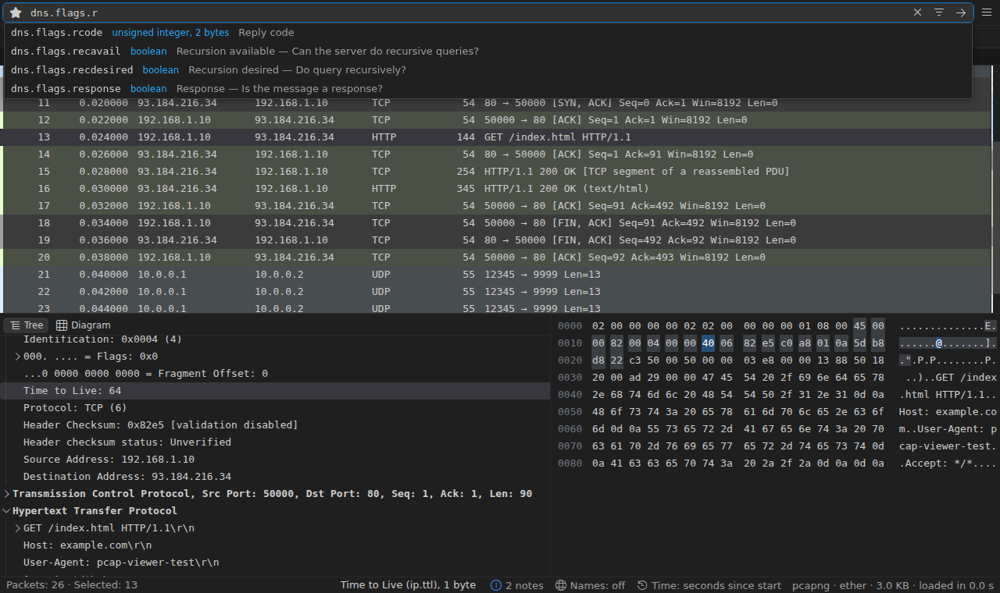

# Filters and Search

## Display filters

The filter bar takes Wireshark's display filter syntax:
`tcp.port == 443`, `dns.flags.rcode != 0`, `http.request.method == "POST"`,
`ip.addr == 10.0.0.0/8 && !arp`.

- **Checked as you type**: the bar turns red when tshark refuses the filter
  and underlines the part it refused; fields, operators and values are
  colored.
- **Autocomplete** from tshark's own field list (your Lua dissectors' fields
  too), with each field's type and description. `Tab` takes the first
  suggestion, `Ctrl+Space` lists operators; `Enter` always applies.
- **History, saved filters and buttons**: the ★ button saves the filter or
  picks a saved one (`pcapViewer.savedFilters`); the toolbar's **+** adds a
  one-click filter button (`pcapViewer.filterButtons`).
- **Streaming**: matches appear as tshark finds them, with a progress bar;
  ■ stops a long filter and keeps the matches found so far.
- **When nothing matches**, the list says why: a field that occurs in no
  packet, or a case-sensitive comparison (with a `lower(…)` suggestion), and
  offers to clear the filter, go back to the previous one or build another.

## Filter builder

**PCAP: Build Display Filter…** (the bar's build button, or _Build Filter
from Field…_ in the details menu) finds a field by name or description,
offers the relations its type allows and the values seen in the capture
with their counts, and combines the result with the current filter
(replace, and, or, and not).

## Filters from packets

Right-click a field, a list cell or a statistics row for **Apply as
Filter ›** or **Prepare as Filter ›**: Selected, Not Selected, and with a
filter applied, …and / …or (not) Selected. The row menu's **Conversation
Filter ›** filters by the packet's Ethernet, IP, TCP or UDP conversation.

## Find Packet

**PCAP: Find Packet…** (`Ctrl+F`) searches by display filter, text, regular
expression or hex bytes; text is searched in the packet bytes, the list's
columns or the details, case-sensitive or not. `F3` and `Shift+F3` go to the
next and previous match; matches show in the overview strip.

## Moving around

- **Go to Packet** (`Ctrl+G`), first and last (`Ctrl+Home`, `Ctrl+End`).
- **Frame links**: fields that name another packet (a response's request,
  a reassembled message's segments) are links; `Alt+Left` and `Alt+Right`
  go back and forward through the jumps. Rows related to the selected
  packet get a mark in the list.
- **Conversation stepping**: `Ctrl+.` and `Ctrl+,` go to the next and
  previous packet of the same conversation.

## Name resolution

**PCAP: Name Resolution…** chooses which names replace addresses and ports:
MAC vendors, IP host names from the capture's DNS answers and your hosts
file, transport port names. Looking names up on the network is off unless
you allow it (`pcapViewer.nameResolution.external`). Filters on a cell with
a name use its address.
