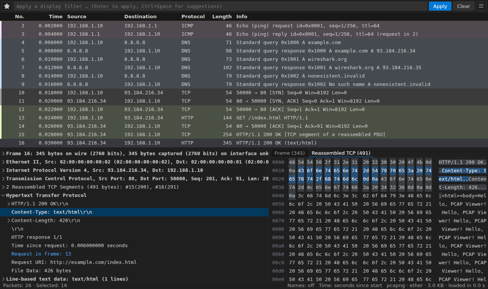

# PCAP Lens

**PCAP Lens** is a Wireshark-like viewer for packet captures inside VS Code.
It opens `.pcap`, `.pcapng` and the other formats Wireshark reads, and
gives you the packet list, the protocol tree, the bytes, display filters,
statistics, followed streams, VoIP calls, live capture, capture editing and
optional AI help. **tshark**, Wireshark's command-line tool, does all the
dissection and filtering, so the results are Wireshark's.



- **Install**:
  [VS Code Marketplace](https://marketplace.visualstudio.com/items?itemName=denpaz.pcap-viewer),
  [Open VSX](https://open-vsx.org/extension/denpaz/pcap-viewer), or a
  `.vsix` from [the releases](https://github.com/DenPaz/pcap-lens/releases).
  The extension ID is `denpaz.pcap-viewer`.
- **Needs**: tshark 4.x and Python 3.12 or newer (standard library only:
  nothing to `pip install`). See [Installation and Setup](Installation-and-Setup).
- **Changes**: [CHANGELOG](https://github.com/DenPaz/pcap-lens/blob/main/CHANGELOG.md).
- **Problems or ideas**: [Issues](https://github.com/DenPaz/pcap-lens/issues);
  security reports through
  [private advisories](https://github.com/DenPaz/pcap-lens/security).

## Guides

| Page                                                   | What it covers                                                                |
| ------------------------------------------------------ | ----------------------------------------------------------------------------- |
| [Installation and Setup](Installation-and-Setup)       | tshark, Python, the walkthrough, remote windows, Restricted Mode              |
| [Opening Captures](Opening-Captures)                   | File types, compressed and rotated captures, saved indexes, growing files     |
| [Using the Viewer](Using-the-Viewer)                   | Packet list, details, bytes, diagram, columns, coloring, comments, keys       |
| [Filters and Search](Filters-and-Search)               | Display filters, the filter builder, Find Packet, marks, navigation           |
| [Statistics and Analysis](Statistics-and-Analysis)     | Overview, conversations, sessions, sequence check, streams, VoIP, expert info |
| [Capture, Edit and Export](Capture-Edit-and-Export)    | Live capture, capture to files, editing, merging, exports, reports            |
| [Dissection and Decryption](Dissection-and-Decryption) | Lua dissectors, Decode As, preferences, profiles, plugins, keys, GeoIP        |
| [Replay to Service](Replay-to-Service)                 | Sending a capture's client traffic to live services, and its command line     |
| [AI Features and Privacy](AI-Features-and-Privacy)     | The PCAP Lens agent, chat tools, `@pcap`, what is sent and the settings       |
| [MCP Server](MCP-Server)                               | Claude Code, Claude Desktop, Cursor and VS Code agents reading your captures  |
| [Troubleshooting](Troubleshooting)                     | Common errors and how to fix them                                             |

## In one minute

1. Install tshark and Python 3.12+, then run **PCAP: Get Started** from the
   Command Palette: it checks both and opens a sample capture.
2. Open any capture: it shows its first rows within half a second, even
   with millions of packets.
3. Type a display filter (`dns || http`) in the bar; suggestions come from
   tshark's own fields.
4. Open **☰** for every command, grouped and searchable, or right-click a
   packet, a field or a column header.

## How it works

```
Webview (HTML/JS) --postMessage--> Extension host (TypeScript)
                                     | JSON-RPC over stdio
                                     v
                                   Python backend (stdlib only)
                                     | argv-only subprocesses
                                     v
                                   tshark, dumpcap, editcap, mergecap, text2pcap
```

One tshark pass indexes the packet list into a file (8 bytes per packet);
filters keep the matching packet numbers; details dissect only up to the
packet. On a million packets the list shows rows after 0.5 s, a saved index
reopens in 0.01 s, and the backend uses about 125 MB.

PCAP Lens is MIT licensed. tshark is part of Wireshark (GNU GPL v2): the
extension runs the tshark you installed as a separate process and doesn't
bundle, link to or modify it.
