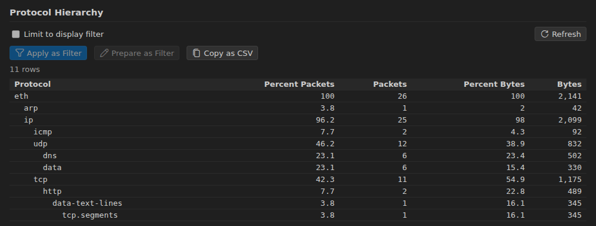

# Statistics and Analysis

Every report opens in a panel beside the capture (or below it:
`pcapViewer.panelPlacement`), can be limited to the current display filter,
and leaves out ignored packets. Its rows apply or prepare a filter, go to a
packet or copy; right-click a row for the full menu. The statistics are in
the editor title's chart menu and in **☰ › Statistics**.

## Capture Overview

**Capture Overview** shows the capture on one page: totals and rates,
packets or bytes over time (click a bar to filter that interval), the
busiest addresses, protocols, TCP services, HTTP methods, status codes and
hosts, DNS results and names, and TLS versions and server names. Every row
applies its filter, and every card opens its full report.

## General

- **Capture File Properties**: packets, times, size, link type, format.
- **Protocol Hierarchy**, **Conversations** and **Endpoints** (Ethernet,
  IPv4, IPv6, TCP, UDP). With MaxMind databases
  (`pcapViewer.geoip.databaseFolders`) the endpoints get country, city and
  AS columns and a world map.
- **Expert Information**: problems tshark found, by severity, each with its
  packets.
- **I/O Graph**: up to eight graphs of packets, bytes or a field's
  SUM/COUNT/MAX/MIN/AVG, as lines or bars, on a linear or log scale.
- **Flow Graph**: the conversation between hosts as arrows over time.

## Sessions

- **HTTP Requests**: each request with its response status, content type,
  size and response time (or _No response_); _Show Response Body_ decodes the
  body (de-chunked, decompressed).
- **DNS Queries**: name, type, result, answers and latency.
- **TLS Servers**: server name, connections, handshakes that got no
  ServerHello, the versions, cipher suites and ALPN the server chose.

## Sequence Check

**Sequence Check** finds messages missing, duplicated, late or restarted by
a field that numbers them, per stream. Name the fields that tell streams
apart and the field that numbers the messages, for example:

| Traffic                  | Streams by                  | Sequence field                 |
| ------------------------ | --------------------------- | ------------------------------ |
| GTP-U tunnels            | `gtp.teid`                  | `gtp.seq_number`               |
| An interception delivery | its LIID and CIN fields     | its sequence number field      |
| Your own protocol        | your Lua dissector's fields | your dissector's counter field |

Set **Counter wraps at** to 8, 16, 24 or 32 bits when the counter wraps.
Streams with problems come first; each problem is a row that goes to its
packet.

## Services and network

- **HTTP**, **DNS**, **SIP Statistics**, **Packet Lengths**, **Service
  Response Time** (ICMP and the protocols tshark times).
- **IPv4/IPv6 Statistics**, **UDP Multicast Streams** (bandwidth and
  bursts), **Resolved Addresses**, **SCTP Associations**.
- **Credentials**: logins sent in clear text (HTTP basic auth, FTP, POP,
  IMAP…), with the packet holding each user name.

## Streams

- **Follow Stream**: TCP, UDP, TLS, HTTP, HTTP/2, QUIC and WebSocket, as
  ASCII, UTF-8/16, EBCDIC, hex dump, C array, raw or YAML, each direction
  or both, with search. HTTP/2 and QUIC let you pick the stream inside the
  connection. _Filter Out This Stream_ hides it from the list.
- **TCP Stream Graph**: Stevens (sequence numbers), throughput, round-trip
  time and window scaling, for one connection.

## VoIP

**VoIP Calls** lists SIP, H.323, MGCP and IAX2 calls with caller, callee,
state, release reasons (Q.850), who hung up, ringing and setup times, the
voice quality of their streams (MOS from the E-model), DTMF and the problems
found: one-way audio, no RTP, codec mismatch, SSRC change, silences.

- The **call flow** shows the signalling and the media streams; rows go to
  their packets.
- **RTP analysis** per stream: loss, jitter, delta and skew, each lost or
  late packet, and what the receiver reported in RTCP.
- **Play** a stream or a whole call (stereo, with a waveform), or save it.
  G.711, G.722, G.726 and L16 are decoded; other codecs can be saved raw.
- _Save Call…_ exports the call's packets to a new capture.

## Export Objects

**Export Objects…** lists the files carried over HTTP, SMB, TFTP, IMF
(e-mail), DICOM and FTP-DATA, with their names, types, sizes and packets,
and saves one or all of them.
