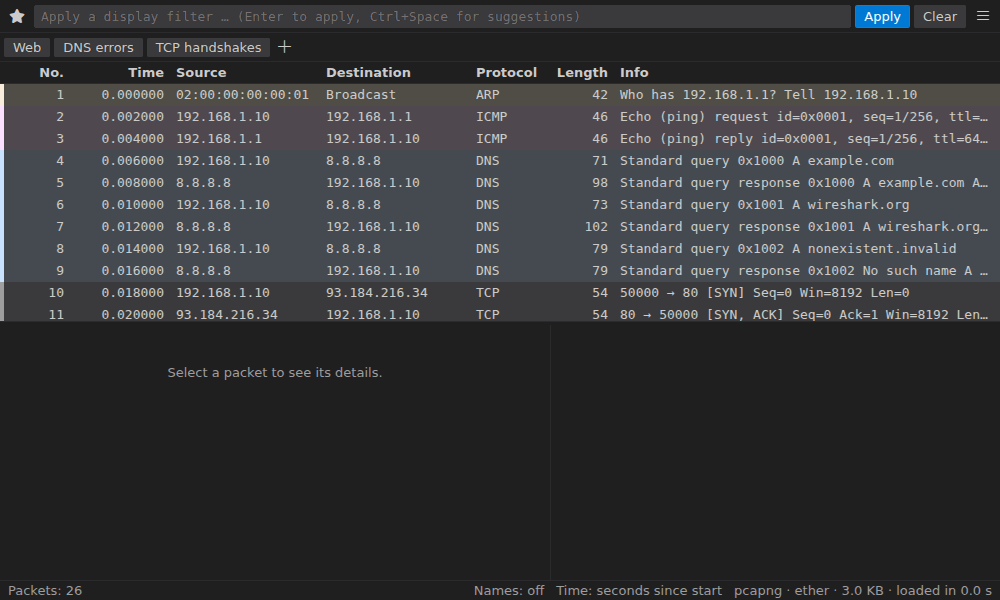
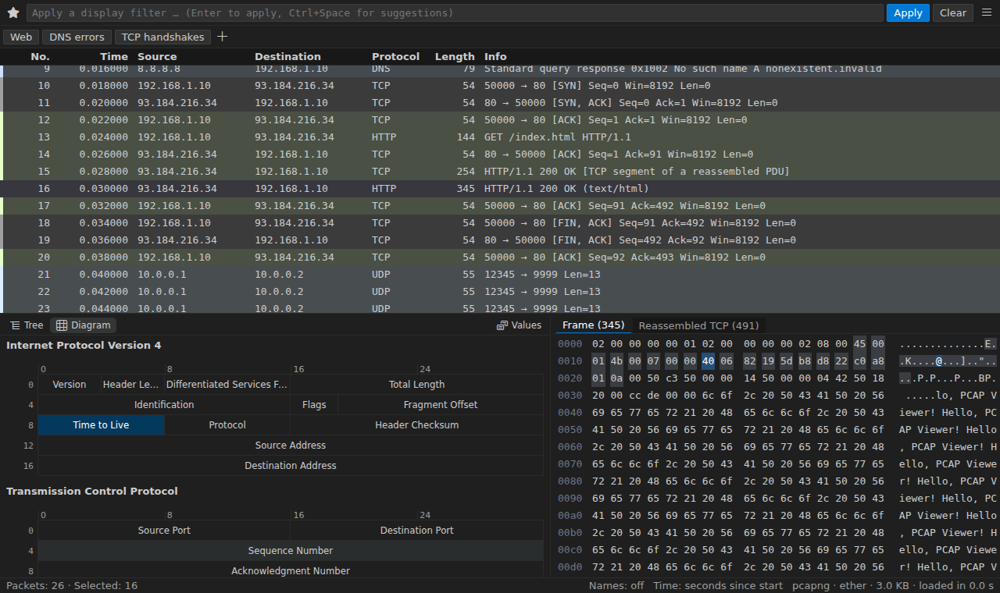

# Using the Viewer

## Layout

The viewer has the filter bar and toolbar at the top, the packet list, then
the packet's details (protocol tree) and bytes. The toolbar's **Pane
Layout** button puts the details and bytes below the list, stacked or
beside it, with or without the bytes (`pcapViewer.paneLayout`,
`pcapViewer.showBytesPane`). Drag the splitters, or focus one and use the
arrow keys.

Every command is in the **☰** menu at the end of the filter bar, grouped
and searchable, with its keyboard shortcut; recently used ones come first.
Right-click a packet, a field, a byte or a column header for the commands
that apply to it. `Shift+F10` opens the same menus from the keyboard.

## Packet list

- **Columns**: click a header to sort (the backend sorts every packet, not
  just the visible ones). Drag a separator to resize a column; double-click
  it to fit the column to its contents, as in a spreadsheet. The header's
  menu hides, shows, renames and reorders columns.
- **Custom columns**: right-click a field in the details and pick _Apply as
  Column_, or use **PCAP: Manage Custom Columns**.
- **Time**: **PCAP: Time Display Format…** (also the status bar) switches
  between seconds since the start, since the previous packet, absolute times
  and more; **PCAP: Set/Unset Time Reference** (`Ctrl+T`) measures from a
  packet.
- **Density**: compact, normal or comfortable rows (`pcapViewer.listDensity`).
- **Overview strip**: beside the scroll bar, a strip shows each part of the
  list's coloring, marks, comments and Find matches; click it to jump there.

## Coloring

Packets are colored by rules like Wireshark's, evaluated by tshark.
**PCAP: Edit Coloring Rules** edits them, **PCAP: Colorize with Filter…**
adds one from a filter, and the row menu's _Colorize Conversation_ colors a
conversation until you **Reset Colorization**. **PCAP: Toggle Packet
Coloring** turns colors off. In dark and high-contrast themes the light
Wireshark colors are drawn as a tint or a stripe
(`pcapViewer.coloringStyle`).

## Details and bytes

- The protocol tree and the bytes highlight each other: select a field to
  see its bytes, click a byte to find its field. Reassembled, decrypted and
  decompressed data get their own byte tabs.
- Right-click a field to apply or prepare it as a filter, colorize with it,
  add it as a column, copy it, open its protocol's preferences or disable
  the protocol.
- **Packet diagram**: the details pane's _Diagram_ tab draws each header 32
  bits a row, every field to the bit, like Wireshark's.
- **Show Packet Bytes** (field menu): a field's bytes decoded (Base64,
  gzip/deflate, hex, percent-encoding, quoted-printable, ROT13) and shown as
  text, a hex dump, a C or Rust array, YAML or an image.
- **Show Packet in New Window** and **Show File Format** (the pcap/pcapng
  blocks of the file itself).
- **Compare Packets…**: two packets' trees side by side, differences
  marked.
- The status bar shows the selected field ("Time to Live (ip.ttl), 1 byte")
  and the expert summary (errors, warnings, notes); click the summary for
  Expert Information.

## Marks, ignored packets, comments and selection

- **Marks** (`Ctrl+M`) highlight packets; `Ctrl+Shift+N` / `Ctrl+Shift+B`
  go to the next or previous one; marked packets can be exported.
- **Ignored packets** (`Ctrl+D`) stay in the list, dimmed, and are left out
  of statistics and exports.
- **Packet comments** in pcapng files: `Ctrl+Alt+C` adds or edits one in the
  bar above the details. Edits have undo and redo and are saved with
  `Ctrl+S`; saving a pcap asks to save a pcapng instead.
- **Multi-select**: `Ctrl`/`Cmd`+click and `Shift`+click, `Ctrl+A` for
  every packet in the view. The row menu then acts on the selection: copy
  rows, mark, export selected packets, ask Copilot about them.

## Keyboard shortcuts

`Cmd` for `Ctrl` on macOS; `?` in the viewer lists them all.

| Key                               | Action                                 |
| --------------------------------- | -------------------------------------- |
| `Ctrl+/`                          | Apply display filter                   |
| `Ctrl+F`, `F3`, `Shift+F3`        | Find packet, next, previous            |
| `Ctrl+G`, `Ctrl+Home`, `Ctrl+End` | Go to packet, first, last              |
| `Alt+Left`, `Alt+Right`           | Back / forward                         |
| `Ctrl+.`, `Ctrl+,`                | Next / previous packet in conversation |
| `Ctrl+M`, `Ctrl+Shift+N` / `B`    | Mark; next / previous marked           |
| `Ctrl+D`, `Ctrl+T`, `Ctrl+Alt+C`  | Ignore, time reference, packet comment |
| `Ctrl+A`, `Shift`/`Ctrl`+click    | Select all, select a range or more     |
| `Shift+F10`                       | Context menu                           |
